# Avícola

**Sistema web para la gestión de granjas avícolas.** Lleva en un solo lugar las aves, la producción de
huevos, los sensores de los galpones, el inventario, las ventas con su caja, las tareas del personal y
los reportes, para una o varias fincas y para varias empresas a la vez.


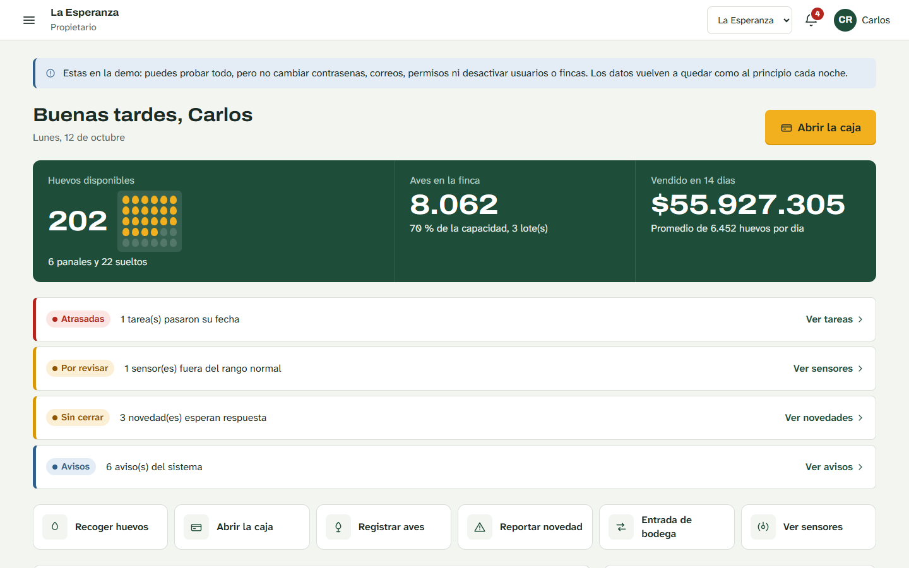

📘 **[Manual de usuario](docs/manual-usuario.md)**: qué puede hacer el dueño, el supervisor, el cajero y el operario, paso a paso y con capturas.

---

## Demo en vivo

🌐 **https://granja-breiner.eastus2.cloudapp.azure.com**

La demo tiene dos fincas con seis meses de trabajo simulado. Entra con cualquiera de estos usuarios (contraseña para todos: `Granja2026`):

| Usuario | Rol | Qué puede ver |
|---|---|---|
| `dueno@demo-avicola.com` | Propietario | Todo: 2 fincas, reportes, usuarios y roles |
| `supervisor@demo-avicola.com` | Supervisor | Lotes, vacunas, tareas y sensores |
| `operario1@demo-avicola.com` | Operario | La vista del trabajador |
| `caja@demo-avicola.com` | Cajero | Caja con turno abierto |

> La demo se restaura sola cada noche: lo que cambies se borra y vuelve a quedar como al principio.
> En la demo no se pueden cambiar contraseñas, correos ni permisos (ver [Demo pública](#demo-pública)).

## Contenido

- [Demo en vivo](#demo-en-vivo)
- [Qué hace](#qué-hace)
- [Capturas](#capturas)
- [Tecnologías](#tecnologías)
- [Arquitectura](#arquitectura)
- [Instalación con Docker](#instalación-con-docker)
- [Instalación sin Docker](#instalación-sin-docker)
- [Datos de ejemplo](#datos-de-ejemplo)
- [Variables de entorno](#variables-de-entorno)
- [Conectar los sensores](#conectar-los-sensores)
- [Pruebas](#pruebas)
- [Estructura del proyecto](#estructura-del-proyecto)
- [Cómo funcionan los accesos](#cómo-funcionan-los-accesos)
- [Reglas del negocio](#reglas-del-negocio)
- [Seguridad](#seguridad)
- [Poner en un servidor](#poner-en-un-servidor)
- [Solución de problemas](#solución-de-problemas)
- [Licencia](#licencia)
- [Autor](#autor)

---

## Qué hace

| Módulo | Funciones |
|---|---|
| **Cuentas y fincas** | Varias empresas (o personas) en el mismo sistema, cada una con sus fincas y sus datos totalmente separados |
| **Galpones y lotes** | Galpones con capacidad y ocupación; lotes con raza, edad y costo; mortalidad, descarte, ventas, fugas, traslados; cierre del lote |
| **Producción de huevos** | Recolección diaria por tipo (Super, AAA, AA, A, B, sucios, rotos), porcentaje de postura y huevos disponibles |
| **Sanidad** | Vacunas, medicamentos, vitaminas y desinfecciones, con próximo refuerzo y descuento de la bodega |
| **Alimento y pesajes** | Alimento entregado por lote (descuenta del inventario y suma al costo), pesajes con peso promedio |
| **Sensores** | Temperatura, humedad, amoníaco, CO₂, luz, agua y silo; estado en tiempo real, historial filtrable por días y gráfica con el rango normal |
| **Inventario** | Bodega central y bodegas por finca; entradas, salidas, traslados y ajustes por conteo; costo promedio; stock mínimo |
| **Ventas y caja** | Puntos de venta con numeración propia, productos por presentación, historial de precios, apertura y cierre de caja, descuentos en porcentaje con tope, varias formas de pago, anulaciones |
| **Tareas y rutinas** | Tareas del día con responsable y prioridad; rutinas diarias, semanales o mensuales |
| **Novedades** | Daños, clima, plagas, cortes de servicios, robos y salud del lote, con gravedad, costo y cierre |
| **Avisos** | Campana con stock bajo, sensores fuera de rango, refuerzos, tareas atrasadas, novedades graves y cajas sin cerrar; se cierran solos |
| **Reportes** | Producción, ventas, aves, alimento y pendientes por periodo; descarga en CSV para Excel |
| **Importar desde Excel** | Sube el archivo con su propio formato, empareja columnas, revisa antes de guardar y deshace si hace falta |
| **Usuarios y permisos** | Seis roles con permisos editables por módulo (ver, crear, editar, borrar) |
| **Registro de cambios** | Quién hizo qué, cuándo y en qué finca |
| **Celular** | Diseño adaptable e instalable como aplicación (PWA) |

---

## Capturas

| Caja con una venta en curso | Reportes del periodo |
|---|---|
| 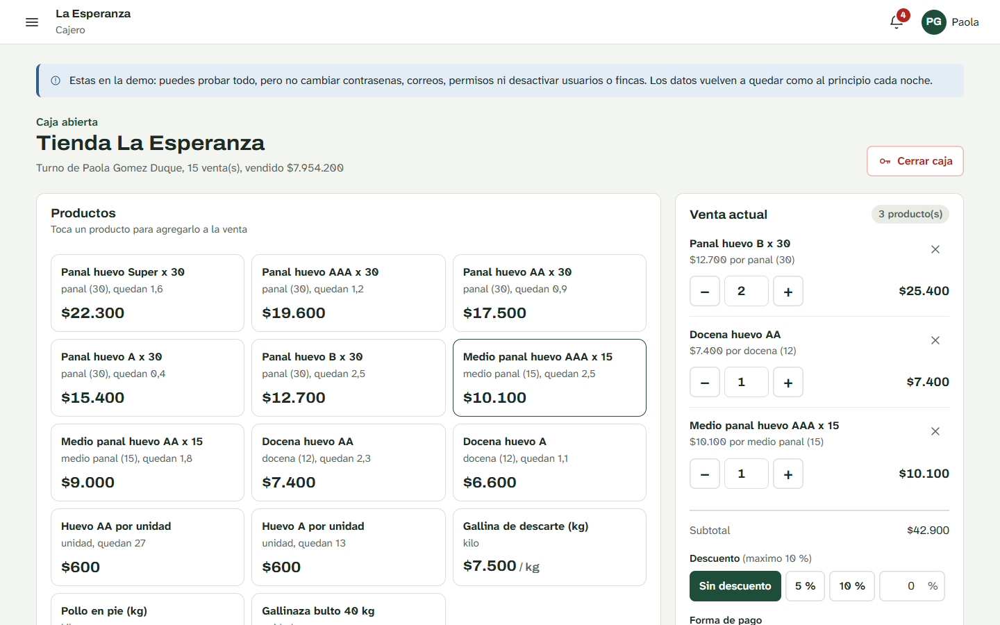 | 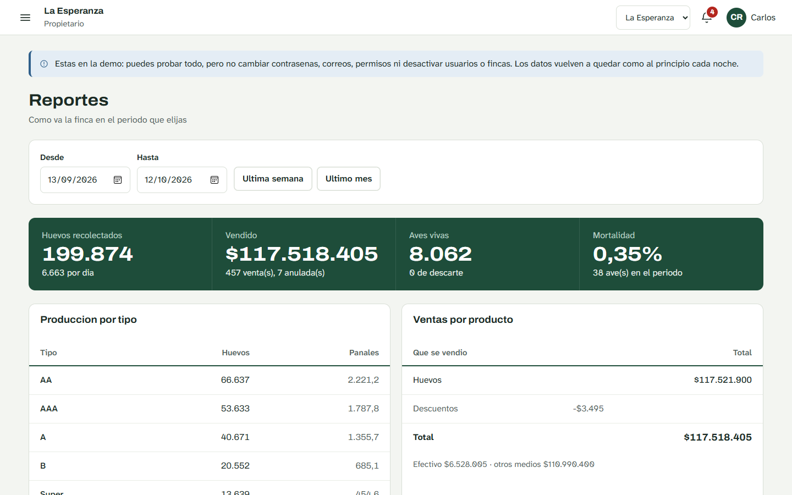 |

| Lotes de aves | Inventario de las bodegas |
|---|---|
| 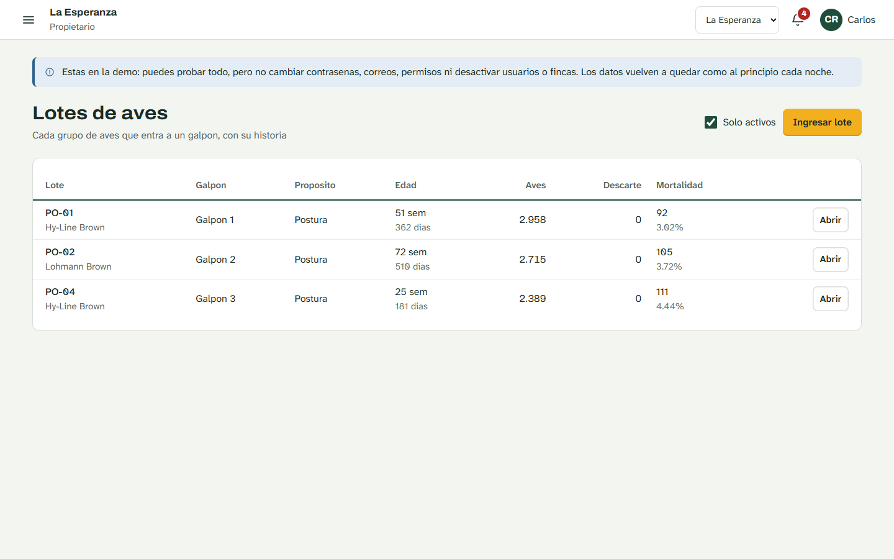 | 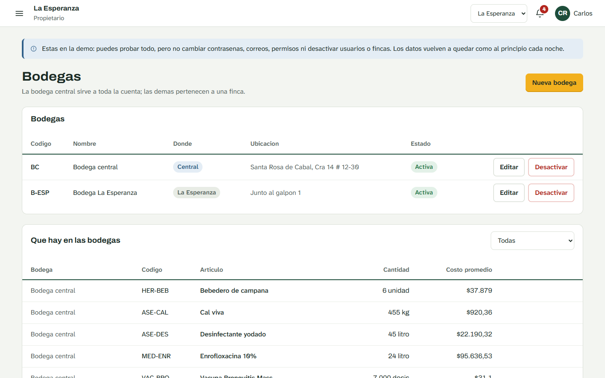 |

| Importar desde Excel | Avisos |
|---|---|
| 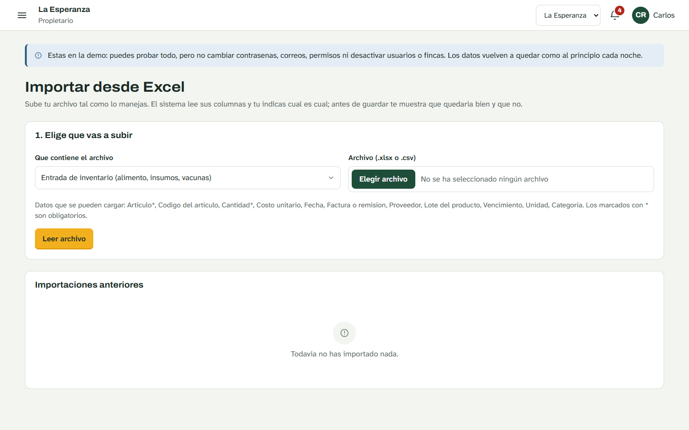 | 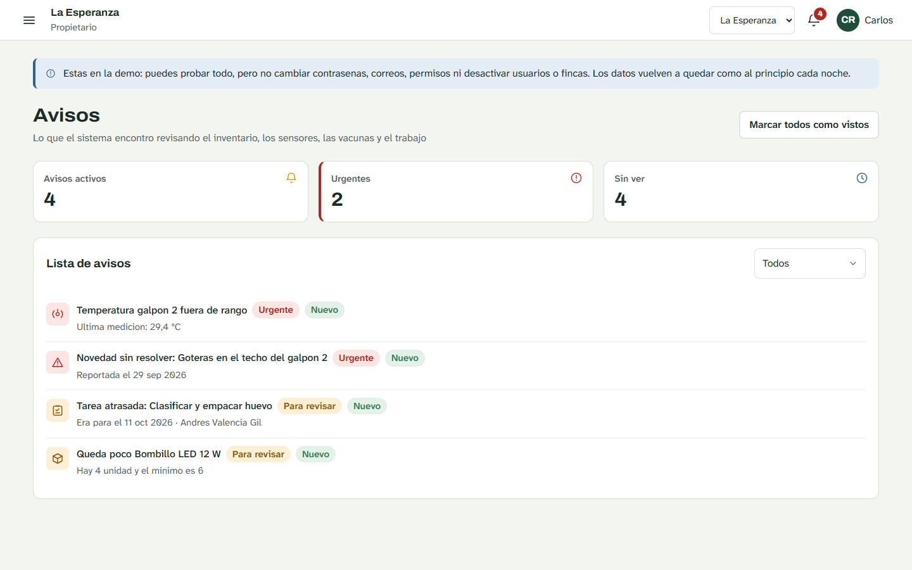 |

En el celular, el panel pone primero los accesos del operario y la caja deja el cobro al alcance del pulgar:

| Panel | Caja | Entrar |
|---|---|---|
| 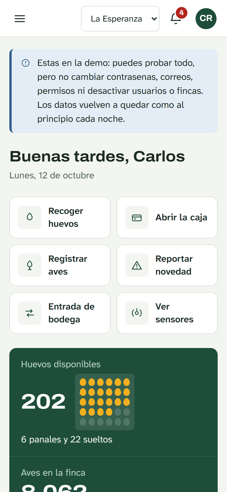 | 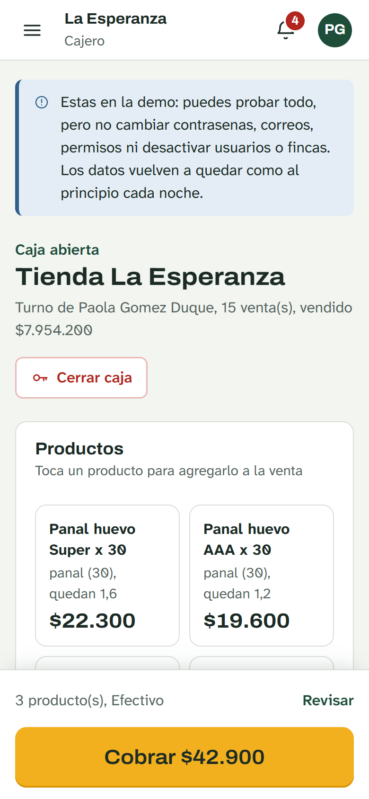 | 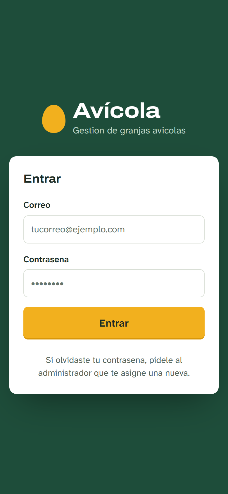 |

Más pantallas, y cómo se usa cada una, en el [manual de usuario](docs/manual-usuario.md).

---

## Tecnologías

**Backend (`api/`)**

- Python 3.11, **FastAPI**, Pydantic v2
- **SQLAlchemy 2** (modelos tipados) y **Alembic** (migraciones)
- **MySQL 8.4** con PyMySQL
- JWT (python-jose) + token de refresco en cookie `HttpOnly`; contraseñas con bcrypt
- **Redis** para limitar intentos de inicio de sesión (con respaldo en memoria)
- openpyxl para leer Excel
- pytest (110 pruebas contra MySQL real)

**Frontend (`web/`)**

- **Next.js 15** (App Router) con **TypeScript**
- **Tailwind CSS 4**
- sonner (notificaciones), gráficas propias en SVG
- PWA: manifiesto e íconos para instalarla en el celular

**Infraestructura**

- **Docker Compose**: base de datos, caché, API y web
- GitHub Actions corre las pruebas, revisa las migraciones y compila la web en cada push (`.github/workflows/pruebas.yml`)

---

## Arquitectura

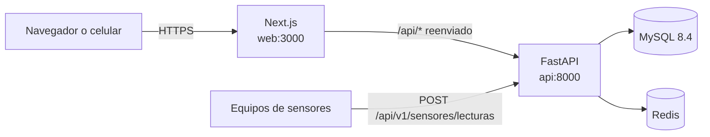

- La web llama a la API por `/api` en el mismo dominio y Next.js reenvía esas rutas al backend. Así la
  cookie de sesión funciona sin configurar CORS.
- Cada petición lleva el token de acceso y la **finca activa** (`X-Finca-Id`). La API valida en cada
  operación el rol, el permiso del módulo y que la finca pertenezca a la cuenta del usuario.
- Las reglas del negocio viven en `api/app/servicios/`; las rutas solo reciben, validan y responden.
- La documentación interactiva de la API queda en `http://localhost:8000/docs`.

---

## Instalación con Docker

**Requisitos:** [Docker Desktop](https://www.docker.com/products/docker-desktop/) (Windows o macOS) o
Docker Engine con Compose (Linux), y Git.

En tu equipo se levanta igual que en la VM: un Caddy delante sirve todo en **http://localhost:8080**, con
el mismo bloque del README (`local/Caddyfile`), y la demo de seis meses se genera sola la primera vez.

```powershell
# 1. Descargar el proyecto
git clone https://github.com/Breiner1412/avicola.git
cd avicola

# 2. Crear el archivo de configuracion local y cambiar sus claves (solo letras y numeros)
copy .env.local.example .env.local          # en Linux/macOS: cp .env.local.example .env.local

# 3. Construir y levantar todo
docker compose -f docker-compose.yml -f docker-compose.local.yml --env-file .env.local up -d --build

# 4. Ver el avance de la demo (la primera vez tarda unos minutos; termina con la lista de usuarios)
docker compose -f docker-compose.yml -f docker-compose.local.yml --env-file .env.local logs -f demo
```

Abre **http://localhost:8080** y entra con los [usuarios de la demo](#datos-de-ejemplo) (clave
`Granja2026`) o con el `ADMIN_EMAIL` y `ADMIN_PASSWORD` del `.env.local` (usuario de plataforma).

| Acción | Comando (desde la carpeta del proyecto) |
|---|---|
| Apagar (los datos se conservan) | `docker compose -f docker-compose.yml -f docker-compose.local.yml --env-file .env.local down` |
| Borrar todo (base, demo e imágenes) | `docker compose -f docker-compose.yml -f docker-compose.local.yml --env-file .env.local down -v --rmi local` |

En local no hay HTTPS: por eso `.env.local` usa `ENTORNO=desarrollo` y `COOKIE_SEGURA=false`.

### Comandos útiles

| Acción | Comando |
|---|---|
| Ver los registros de la API | `docker compose logs -f api` |
| Detener | `docker compose down` |
| Empezar de cero (**borra la base de datos**) | `docker compose down -v` |
| Actualizar después de un cambio en el código | `docker compose -f docker-compose.yml -f docker-compose.local.yml up -d --build` |
| Reiniciar la contraseña del admin | `docker compose exec api python -m app.semilla --reiniciar-admin` |
| Restaurar los permisos de fábrica | `docker compose exec api python -m app.semilla --forzar-permisos` |
| Cargar datos de ejemplo | `docker compose exec api python -m app.demo` |

---

## Instalación sin Docker

**Requisitos:** Python 3.11, Node.js 22, MySQL 8 y (opcional) Redis.

```bash
# --- API ---
cd api
cp .env.example .env                     # ajusta DB_HOST=127.0.0.1 y los datos de tu MySQL
python -m venv .venv
. .venv/bin/activate                     # Windows: .venv\Scripts\activate
pip install -r requirements-dev.txt
alembic upgrade head                     # crea las tablas
python -m app.semilla                    # módulos, roles, permisos y usuario admin
uvicorn app.main:app --reload            # http://localhost:8000

# --- Web (en otra terminal) ---
cd web
npm install
npm run dev                              # http://localhost:3000
```

Si la API no está en `http://localhost:8000`, indica dónde con la variable `API_INTERNA` antes de
`npm run dev`.

---

## Datos de ejemplo

Para ver el sistema como si una granja llevara **seis meses** usándolo:

```bash
docker compose exec api python -m app.demo
# sin Docker: cd api && python -m app.demo
```

Tarda unos 3 minutos y crea la cuenta **Granja Avícola La Esperanza** con:

- 2 fincas: *La Esperanza* (gallinas ponedoras) y *El Recreo* (pollo de engorde)
- 6 galpones, 11 lotes (incluido un lote viejo que se descarta y unas pollitas que pasan a postura)
- 7 usuarios con todos los roles
- ~180 días de recolección de huevos, alimento, mortalidad, pesajes, vacunas y desinfecciones
- ~2.900 ventas con su caja diaria, descuentos, pagos por transferencia y algunas anulaciones
- compras, traslados, salidas y conteos de inventario
- rutinas y tareas diarias, novedades y ~20.000 mediciones de 9 sensores

Todo se registra con las mismas reglas del sistema, así que el inventario, las aves y las cajas cuadran.

| Usuario | Rol |
|---|---|
| `dueno@demo-avicola.com` | Propietario |
| `admin@demo-avicola.com` | Administrador |
| `supervisor@demo-avicola.com` | Supervisor |
| `operario1@demo-avicola.com` | Operario (La Esperanza) |
| `operario2@demo-avicola.com` | Operario (La Esperanza) |
| `operario3@demo-avicola.com` | Operario (El Recreo) |
| `caja@demo-avicola.com` | Cajero |

Contraseña de todos: **`Granja2026`**. Los datos se cargan una sola vez por base de datos; para volver a
cargarlos hay que empezar de cero (`down -v`).

### Demo pública

La demo publicada usa **su propia base** (`DB_NAME=avicola_demo`) y `DEMO=true`. Con eso la API no deja
cambiar contraseñas (propias ni ajenas), correos, roles, permisos ni cuentas, ni desactivar usuarios o
fincas: nadie puede dejar a los demás sin entrar. Todo lo demás se puede probar, y cada noche los datos
vuelven a quedar como al principio.

El reinicio usa un **volcado base** y dos scripts que se corren desde la raíz del proyecto en la VM. Los
dos se niegan a trabajar si `DEMO` no es `true` o si `DB_NAME` no termina en `_demo`.

```bash
# 1. Una vez (y cada semana, para que las fechas no envejezcan): crea la demo y guarda el volcado
sh scripts/demo/crear_base.sh          # 180 días; deja demo/base_demo.sql.gz

# 2. Cada noche: borra la base, carga el volcado, vacía Redis y vuelve a levantar la API (~10 s)
sh scripts/demo/reiniciar.sh
```

Cron del host (`crontab -e` del usuario que maneja Docker; ajusta la ruta del proyecto):

```cron
# Reinicio de la demo todas las noches a las 3:00
0 3 * * *  cd /opt/avicola && sh scripts/demo/reiniciar.sh >> /var/log/avicola-demo.log 2>&1
# Volcado base nuevo cada domingo a las 2:30 (las fechas de la demo terminan ese dia)
30 2 * * 0 cd /opt/avicola && sh scripts/demo/crear_base.sh >> /var/log/avicola-demo.log 2>&1
```

El volcado base guarda tambien el usuario de plataforma con la clave que tenia al crearse: si cambias
`ADMIN_PASSWORD`, vuelve a correr `crear_base.sh` para que el reinicio nocturno no traiga la clave vieja.

Variables opcionales de los scripts: `ENV_FILE` (por defecto `.env`), `COMPOSE_FILE` y `DEMO_BASE`
(por defecto `demo/base_demo.sql.gz`, fuera del repositorio).

---

## Variables de entorno

Se configuran en el archivo `.env` (copia de `.env.example`). **Nunca subas el `.env` al repositorio.**
En las contraseñas usa letras, números, `-`, `_` y `.`: el signo `$` lo interpreta Docker Compose, las
comillas y la barra invertida rompen el SQL que crea el usuario de la aplicación, y `@`, `:` o `/` rompen
la dirección de Redis.

| Variable | Para qué | Ejemplo |
|---|---|---|
| `ENTORNO` | `produccion` en el servidor: exige claves propias, apaga `/docs` y pide Redis | `desarrollo` |
| `DEMO` | `true` solo en la demo pública (ver [Demo pública](#demo-pública)) | `false` |
| `ZONA_HORARIA` | Zona de la granja: define "hoy" y los días de los reportes | `America/Bogota` |
| `TZ` | Hora de los logs de los contenedores | `America/Bogota` |
| `MYSQL_ROOT_PASSWORD` | Contraseña root de MySQL (solo la usa el contenedor de la base y los scripts) | |
| `DB_NAME` | Base de datos (`avicola_demo` en la demo pública) | `avicola` |
| `DB_USER`, `DB_PASSWORD` | Usuario de la aplicación: solo lee y escribe datos | `avicola_app` |
| `DB_MIGRA_USER`, `DB_MIGRA_PASSWORD` | Dueño del esquema, solo para las migraciones (vacíos = usan `DB_USER`) | `avicola` |
| `REDIS_PASSWORD` | Clave de Redis (Docker arma `REDIS_URL` con ella) | |
| `JWT_SECRET` | Clave para firmar las sesiones (**mínimo 32 caracteres**) | `python -c "import secrets; print(secrets.token_urlsafe(48))"` |
| `MINUTOS_ACCESO` | Duración del token de acceso | `30` |
| `DIAS_REFRESCO` | Días que dura la sesión sin volver a entrar | `14` |
| `COOKIE_SEGURA` | `true` con HTTPS (obligatorio en producción) | `true` |
| `ADMIN_EMAIL`, `ADMIN_PASSWORD`, `ADMIN_NOMBRE` | Usuario de plataforma que se crea la primera vez (clave de 12 o más en producción) | |
| `CUENTA_DEMO`, `FINCA_DEMO` | Nombre de la cuenta y la finca que se crean la primera vez | |
| `SMTP_HOST`, `SMTP_PORT`, `SMTP_USER`, `SMTP_PASSWORD`, `SMTP_DESDE` | Correo para recuperar contraseñas | `587` |
| `CORS_ORIGENES` | Orígenes permitidos si se llama la API desde otro dominio (vacío detrás de Caddy) | |
| `PROXY_CONFIABLE` | Redes de las que la API cree `X-Forwarded-For` | `172.16.0.0/12,192.168.0.0/16,10.0.0.0/8` |
| `WEB_PUERTO_HOST`, `API_PUERTO_HOST`, `DB_PUERTO_HOST` | Solo con `docker-compose.local.yml` (en tu equipo) | `3000`, `8000`, `3308` |

Sin Docker (`api/.env`) se usan además `DB_HOST`, `DB_PORT` y `REDIS_URL`.

---

## Conectar los sensores

Los equipos (ESP32, Raspberry Pi, un PLC con pasarela, etc.) envían sus mediciones a la API. Cada
sensor se registra primero en **Aves → Sensores** con un **código** (por ejemplo `TEMP-G1`), y el equipo
usa ese código.

1. Crea en **Usuarios** un usuario para los equipos con rol **Supervisor** y acceso a la finca.
2. El equipo entra y obtiene un token (dura `MINUTOS_ACCESO`; al vencer, vuelve a entrar):

   ```bash
   curl -X POST http://SERVIDOR/api/v1/auth/login \
     -H "Content-Type: application/json" \
     -d '{"email": "equipos@granja.com", "clave": "LaClaveDelEquipo"}'
   ```

3. Envía una o varias mediciones con el código de cada sensor y la finca:

   ```bash
   curl -X POST http://SERVIDOR/api/v1/sensores/lecturas \
     -H "Authorization: Bearer TOKEN" \
     -H "X-Finca-Id: 1" \
     -H "Content-Type: application/json" \
     -d '{"lecturas": [
           {"codigo": "TEMP-G1", "valor": 24.6},
           {"codigo": "HUM-G1",  "valor": 61.3, "medido_en": "2026-09-19T14:30:00-05:00"}
         ]}'
   ```

   Responde cuántas se guardaron y qué códigos no reconoció. Si no se envía `medido_en`, se toma la
   hora de llegada. El sistema marca solo las que estén fuera de rango y avisa en la campana.

---

## Pruebas

```bash
cd api
pip install -r requirements-dev.txt
python -m app.semilla --reiniciar-admin     # deja la clave del admin como está en el .env
python -m pytest -q
```

Son **110 pruebas** de extremo a extremo contra MySQL. Cubren el inicio de sesión y el cambio de
contraseña, los permisos por rol, la elección de finca, galpones, inventario (entradas, salidas,
traslados con su costo, ajustes y anulaciones), lotes (mortalidad, descarte, traslado, producción,
alimento, pesajes y sanidad), ventas (caja, descuentos en porcentaje y su tope, pagos y anulaciones),
importación desde Excel, tareas y novedades, sensores (incluido el envío por código), avisos, reportes y
el registro de cambios; y, lo más importante, que **una cuenta no pueda ver ni tocar los datos de
otra**.

En GitHub corren solas en cada push y pull request (`.github/workflows/pruebas.yml`), junto con
`alembic check` y la compilación de la web.

---

## Estructura del proyecto

```
avicola/
├── docker-compose.yml           # producción: base + caché + API + web, sin puertos publicados
├── docker-compose.local.yml     # en tu equipo: Caddy en localhost:8080 y demo automatica
├── local/Caddyfile              # el bloque de Caddy del README, para localhost
├── .env.example                 # variables de entorno (copiar a .env)
├── .github/workflows/pruebas.yml
├── db/inicio/                   # crea el usuario de la aplicación en MySQL
├── scripts/                     # respaldo y demo (reinicio nocturno)
├── docs/
│   ├── manual-usuario.md        # manual de usuario por rol, con preguntas frecuentes
│   ├── capturas/                # capturas de la web (escritorio y celular)
│   └── DISENO_V2.md             # diseño del sistema
├── api/
│   ├── app/
│   │   ├── main.py              # aplicación FastAPI
│   │   ├── core/                # configuración, base de datos, seguridad, permisos, auditoría
│   │   ├── modelos/             # tablas (SQLAlchemy)
│   │   ├── esquemas/            # validación de lo que entra y sale (Pydantic)
│   │   ├── servicios/           # reglas del negocio (inventario, aves, ventas, avisos...)
│   │   ├── rutas/               # endpoints por módulo
│   │   ├── semilla.py           # datos iniciales
│   │   └── demo/                # seis meses de datos de ejemplo (python -m app.demo)
│   ├── migraciones/             # Alembic
│   └── tests/                   # pruebas
└── web/
    └── src/
        ├── app/                 # pantallas (App Router)
        ├── componentes/         # interfaz reutilizable (menú, campana, gráficas, diálogos...)
        └── lib/                 # cliente de la API, sesión, menú, tipos y formatos
```

---

## Cómo funcionan los accesos

- **Cuenta:** una empresa o una persona. Todo pertenece a una cuenta y ninguna ve los datos de otra.
- **Finca:** cada cuenta puede tener varias; la información se lleva por finca.
- **Finca activa:** al entrar se elige en cuál se trabaja y se puede cambiar desde la barra superior.
- Un supervisor puede tener fincas en modo **solo consulta**.

| Rol | Qué puede hacer |
|---|---|
| Plataforma | Administra el sistema y todas las cuentas |
| Propietario | Todo dentro de su cuenta |
| Administrador | Toda la operación de las fincas de la cuenta |
| Supervisor | Su finca completa; otras fincas de la cuenta solo de consulta |
| Operario | Registra el trabajo diario de su finca |
| Cajero | Atiende el punto de venta |

Los permisos se guardan en la base de datos y se cambian en **Roles y permisos**. El backend los valida
en cada petición; la web solo oculta lo que el rol no puede usar.

---

## Reglas del negocio

- **Nada queda en negativo:** existencias, aves de un lote y huevos disponibles.
- **Nada se borra, se anula:** ventas y movimientos quedan en el historial con motivo, quién y cuándo.
- **El costo viaja con el artículo:** cada entrada recalcula el costo promedio; traslados y salidas se
  valoran al costo promedio de la bodega de origen.
- **El descarte** saca a las gallinas del conteo de producción pero siguen en el galpón hasta venderse.
- **La venta descuenta lo que sale:** huevos de los disponibles de la finca y aves del lote y del galpón.
- **Descuentos en porcentaje** con tope configurable para cajero, operario y supervisor.
- **El cajero solo anula ventas de su turno abierto.**
- **La producción se corrige, no se duplica:** registrar el mismo lote y día reemplaza el registro.
- **Los avisos se recalculan** y se cierran solos cuando el problema se resuelve.
- **Las importaciones se pueden deshacer.**

---

## Seguridad

- Token de acceso corto (JWT) y token de refresco en cookie `HttpOnly`; las sesiones se pueden revocar.
- Contraseñas con bcrypt; límite de intentos en el inicio de sesión.
- Permisos validados en el servidor en cada operación, con aislamiento estricto entre cuentas.
- Cada operación importante queda en el registro de cambios.
- Los errores internos se responden con un mensaje genérico, sin detalles de la base de datos.
- El `.gitignore` deja por fuera el `.env`, `node_modules/`, `.next/` y los temporales de Python.

---

## Poner en un servidor

Pensado para una máquina virtual Linux (Azure, AWS, DigitalOcean…) con **Docker** y un **Caddy** que ya
da HTTPS a otras apps. Ningún contenedor de Avícola publica puertos: Caddy es el único que expone 80 y 443
y llega a la web y a la API por la red de Docker `proxy`.

```text
Internet ──443──> Caddy ──/api/*──> avicola-api:8000 ──┐
                    │                                  ├── red "interna" ── avicola-db, avicola-cache
                    └──── resto ───> avicola-web:3000 ─┘
                (red "proxy", compartida con las demás apps)
```

### 1. Preparar la VM

```bash
sudo mkdir -p /opt/avicola && sudo chown "$USER" /opt/avicola
git clone https://github.com/Breiner1412/avicola.git /opt/avicola
cd /opt/avicola
docker network create proxy 2>/dev/null || true   # la red que comparte Caddy (si no existe)
cp .env.example .env && chmod 600 .env
```

En el `.env` del servidor:

- `ENTORNO=produccion` y `COOKIE_SEGURA=true` (la API no arranca en producción con las claves de
  ejemplo ni sin cookie segura).
- Claves nuevas para `MYSQL_ROOT_PASSWORD`, `DB_PASSWORD`, `DB_MIGRA_PASSWORD`, `JWT_SECRET` y
  `ADMIN_PASSWORD` (12 caracteres o más).
- Para la demo pública: `DEMO=true` y `DB_NAME=avicola_demo` (ver [Demo pública](#demo-pública)).

### 2. Levantar

```bash
docker compose up -d --build
docker compose ps        # avicola-db, avicola-cache, avicola-api y avicola-web deben quedar "healthy"
```

`avicola-migrar` corre antes que la API: aplica las migraciones y los datos iniciales y termina (sale con
código 0). Es el único contenedor con las credenciales del dueño del esquema; la API trabaja con un usuario
que no puede crear ni quitar tablas ni triggers. Si una migración falla, la API no arranca:

```bash
docker compose logs migrar
```

### 3. Caddy

En el `Caddyfile` del Caddy compartido (que debe estar en la red `proxy`):

```caddy
granja.ejemplo.com {
	encode zstd gzip

	# HSTS solo para este dominio (sin includeSubDomains: otras apps comparten el dominio padre).
	# Las demas cabeceras de seguridad (CSP, nosniff, frame-ancestors...) las pone la aplicacion.
	header Strict-Transport-Security "max-age=31536000"
	header -Server

	# La API va directo a su contenedor: Caddy le pasa la IP real del visitante
	# (los limites de intentos y el registro de cambios la usan)
	handle /api/* {
		# Tope al tamano de lo que se envia: el Excel admite 5 MB, lo demas es JSON
		@importacion path /api/v1/importacion/analizar
		@resto not path /api/v1/importacion/analizar
		request_body @importacion {
			max_size 6MB
		}
		request_body @resto {
			max_size 1MB
		}
		reverse_proxy avicola-api:8000
	}

	# Todo lo demas es la aplicacion web
	handle {
		reverse_proxy avicola-web:3000
	}
}
```

Y se recarga sin cortar las demás apps:

```bash
docker exec caddy caddy reload --config /etc/caddy/Caddyfile   # usa el nombre de tu contenedor de Caddy
```

La API solo cree la cabecera `X-Forwarded-For` (la IP del visitante) de los proxies de `PROXY_CONFIABLE`.
Por defecto son las redes privadas de Docker, lo que incluye a **cualquier contenedor de la red `proxy`**,
también los de otras apps. Lo recomendado es dejar solo a Caddy, con una IP fija en la red `proxy`:

```yaml
# En el docker-compose de Caddy
services:
  caddy:
    networks:
      proxy:
        ipv4_address: 172.30.0.2
networks:
  proxy:
    external: true
```

```bash
# Si la red proxy aun no existe, crearla con una subred conocida
docker network create --subnet 172.30.0.0/24 proxy
# Y en el .env de Avicola
PROXY_CONFIABLE=172.30.0.2
```

Sin esto, otra app de la VM podría hacerse pasar por cualquier IP ante la API. Desde internet no se puede:
Caddy reescribe esa cabecera. La API corta de todos modos los cuerpos de más de 1 MB (6 MB en la
importación) aunque le lleguen sin pasar por Caddy.

### 4. Firewall

En el grupo de seguridad de Azure deja abiertos solo **80**, **443** y el **22** (SSH, mejor limitado a tu
IP). La base de datos, Redis y la API no tienen puertos publicados.

### 5. Respaldos

`scripts/respaldo.sh` saca un `mysqldump` consistente (`--single-transaction`, con los triggers del
registro de cambios), lo comprime, verifica que quedó completo y borra los de más de 14 días:

```bash
sudo mkdir -p /var/backups/avicola && sudo chown "$USER" /var/backups/avicola
sh scripts/respaldo.sh                         # deja /var/backups/avicola/<base>_AAAA-MM-DD_HHMM.sql.gz
```

Cron del host (`crontab -e`), todos los días a las 2:00, antes del reinicio de la demo:

```cron
0 2 * * *  cd /opt/avicola && sh scripts/respaldo.sh >> /var/log/avicola-respaldo.log 2>&1
```

El comando que hace por dentro, por si lo quieres correr a mano:

```bash
docker compose exec -T db sh -c 'MYSQL_PWD="$MYSQL_ROOT_PASSWORD" mysqldump -uroot \
  --single-transaction --quick --routines --triggers --events --hex-blob \
  --default-character-set=utf8mb4 --set-gtid-purged=OFF --no-tablespaces "$MYSQL_DATABASE"' \
  | gzip -9 > /var/backups/avicola/avicola_$(date +%F_%H%M).sql.gz
```

Para restaurar (**borra los datos actuales**; detiene la API mientras tanto):

```bash
sh scripts/restaurar.sh /var/backups/avicola/avicola_2026-10-09_0200.sql.gz --confirmo
```

Copia la carpeta de respaldos fuera de la VM (por ejemplo a Azure Blob Storage con `azcopy sync`): si
se pierde el disco, se pierden también los respaldos que estén en él.

### Si ya tenías Avícola corriendo en la VM

La base existente sigue sirviendo (el volumen `avicola_db_datos` no cambia). **Antes de nada, saca un
respaldo con la versión que está corriendo**: en MySQL los cambios de estructura no se pueden deshacer
a mitad de camino, y si una migración falla lo más rápido es restaurar y reintentar.

```bash
cd /opt/avicola
docker compose exec -T db sh -c 'MYSQL_PWD="$MYSQL_ROOT_PASSWORD" mysqldump -uroot --single-transaction --routines --triggers "$MYSQL_DATABASE"' | gzip > ~/antes-de-actualizar.sql.gz
git pull
```

Después, crear una vez el usuario de la aplicación, que no puede tocar el registro de cambios:

```bash
# En el .env: DB_MIGRA_USER y DB_MIGRA_PASSWORD = el usuario y la clave que ya tenias en DB_USER/DB_PASSWORD;
# DB_USER=avicola_app y DB_PASSWORD = una clave nueva
docker compose up -d db
docker compose exec db sh /docker-entrypoint-initdb.d/01-usuario-app.sh
docker compose up -d --build      # las migraciones crean los triggers y los permisos por empresa
```

Para pasar la demo pública a su propia base (`avicola_demo`), después de lo anterior: en el `.env` pon
`DEMO=true` y `DB_NAME=avicola_demo`, saca un respaldo de la base vieja y luego:

```bash
sh scripts/respaldo.sh                                        # por si acaso, la base anterior
docker compose up -d db                                       # recrea el contenedor con el nombre nuevo
docker compose exec db sh /docker-entrypoint-initdb.d/01-usuario-app.sh   # permisos sobre avicola_demo
sh scripts/demo/crear_base.sh                                 # crea la base, la llena y deja el volcado base
docker compose up -d --build
```

---

## Solución de problemas

**`exec /bin/sh: exec format error` al construir.** La imagen base se descargó dañada o de otra
arquitectura. Bórrala y vuelve a construir:

```bash
docker image rm -f node:22-alpine python:3.11-slim
docker builder prune -af
docker compose build --no-cache
docker compose up -d
```

**`rpc error: code = Unavailable ... EOF`.** Docker Desktop se quedó sin memoria o se cerró el motor.
Reinicia Docker Desktop y construye los servicios uno a uno (`build api` y luego `build web`).

**La API no arranca y el registro dice que no conecta a la base de datos.** La primera vez MySQL tarda en
iniciar; espera un minuto. Si cambiaste las contraseñas del `.env` después de crear la base, empieza de
cero con `down -v`.

**El puerto 3000, 8000 o 3308 ya está en uso.** Cambia `WEB_PUERTO_HOST`, `API_PUERTO_HOST` o
`DB_PUERTO_HOST` en el `.env`.

**No recuerdo la contraseña del admin.** `docker compose exec api python -m
app.semilla --reiniciar-admin` la deja como está en el `.env`.

---

## Licencia

Este proyecto usa la licencia **GNU General Public License v3.0**. El texto completo está en el archivo
[LICENSE](LICENSE).

En corto: cualquiera puede usar, estudiar, modificar y compartir el código libremente, pero si distribuye
una versión modificada tiene que publicarla también bajo la GPL-3.0 y conservar el crédito original.

Copyright © 2026 Breiner Stiven Guisao Rodríguez

---

## Autor

Desarrollado por **Breiner Stiven Guisao Rodríguez** — Tecnólogo en Análisis y Desarrollo de Software
(SENA). [github.com/Breiner1412](https://github.com/Breiner1412)
