# Manual de usuario de Avícola

Este manual explica cómo usar Avícola en el día a día de la granja. Está escrito para personas que no
trabajan con sistemas: cada tarea tiene sus pasos numerados y una imagen de la pantalla.

No hace falta leerlo completo. Busca tu rol en el contenido y ve directo a tus tareas.

> Las imágenes son de la **demo**, con datos inventados. En tu granja verás tus fincas, tus lotes y tus
> precios, pero las pantallas son las mismas.

## Contenido

1. [Antes de empezar](#1-antes-de-empezar)
2. [Entrar y elegir la finca](#2-entrar-y-elegir-la-finca)
3. [Qué puede hacer cada rol](#3-qué-puede-hacer-cada-rol)
4. [Dueño (propietario)](#4-dueño-propietario)
   - [Revisar el panel](#41-revisar-el-panel)
   - [Ver los avisos](#42-ver-los-avisos)
   - [Ver los reportes](#43-ver-los-reportes)
   - [Importar un Excel](#44-importar-un-excel)
   - [Darle una contraseña nueva a quien la olvidó](#45-darle-una-contraseña-nueva-a-quien-la-olvidó)
5. [Supervisor](#5-supervisor)
6. [Cajero](#6-cajero)
   - [Abrir la caja](#61-abrir-la-caja)
   - [Vender huevos](#62-vender-huevos)
   - [Vender aves por unidad o por kilo](#63-vender-aves-por-unidad-o-por-kilo)
   - [Dar descuento y cobrar](#64-dar-descuento-y-cobrar)
   - [Anular una venta](#65-anular-una-venta)
   - [Cerrar la caja](#66-cerrar-la-caja)
7. [Operario](#7-operario)
   - [Registrar la recolección de huevos](#71-registrar-la-recolección-de-huevos)
   - [Registrar mortalidad](#72-registrar-mortalidad)
   - [Registrar una vacuna o tratamiento](#73-registrar-una-vacuna-o-tratamiento)
   - [Reportar una novedad](#74-reportar-una-novedad)
8. [Recuperar la contraseña](#8-recuperar-la-contraseña)
9. [Preguntas frecuentes](#9-preguntas-frecuentes)
10. [Palabras que usa el sistema](#10-palabras-que-usa-el-sistema)

---

## 1. Antes de empezar

**Qué necesitas:** un computador, una tableta o un celular con internet, la dirección de Avícola que te
dio el administrador de la granja, tu correo y tu contraseña.

**Cómo se lee este manual:**

- Los nombres de botones y opciones van en **negrita**, escritos tal como aparecen en la pantalla.
- **Menú → Aves → Lotes** quiere decir: abre el menú, toca **Aves** y luego **Lotes**.
- El menú se abre con el botón de las **tres rayas** (☰), arriba a la izquierda.

**Los colores de la pantalla te ayudan:**

| Color | Qué quiere decir |
|---|---|
| Botón **amarillo** | La acción principal de esa pantalla: **Guardar**, **Cobrar**, **Entrar** |
| Botón con borde **rojo** | Algo que deshace o cierra: **Anular**, **Cerrar caja**, **Desactivar** |
| Etiqueta **verde** | Todo bien: activa, normal, cuadró |
| Etiqueta **amarilla** | Hay que revisar |
| Etiqueta **roja** | Urgente o con problema |
| Línea de color a la izquierda de una tarjeta | Qué tan importante es: roja, alta; azul, media |

**Nada se borra.** Si algo quedó mal, se **anula** con un motivo. Lo anulado sigue a la vista, tachado,
con quién lo anuló y cuándo.

---

## 2. Entrar y elegir la finca

*Esta parte es para todos.*

### Entrar

1. Abre la dirección de Avícola en el navegador.
2. Escribe tu **Correo** y tu **Contrasena**.
3. Toca **Entrar**.

| En el computador | En el celular |
|---|---|
| 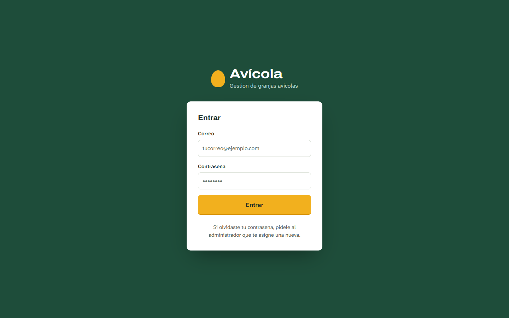 |  |

Si escribes mal la contraseña varias veces seguidas, el sistema espera unos minutos antes de dejarte
intentar de nuevo. Es para proteger tu cuenta.

**La primera vez** que entras con una contraseña que te dio el administrador, el sistema te pide cambiarla
por una tuya, de al menos 8 caracteres.

### Elegir la finca

Si trabajas en más de una finca, después de entrar eliges en cuál vas a trabajar hoy. Si solo tienes una,
entras directo.

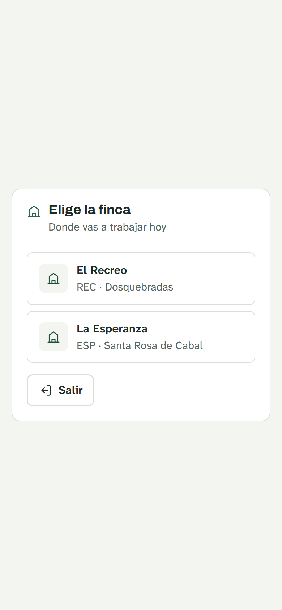

Para cambiar de finca sin salir, usa la lista que está arriba, al lado de la campana.

Si una finca dice **Solo consulta**, puedes mirar su información pero no registrar nada en ella.

### Moverte por el sistema

- **☰** abre el menú. Las opciones están agrupadas: **Aves**, **Operacion**, **Inventario**, **Ventas**,
  **Organizacion** y **Sistema**. Toca un grupo para abrirlo.
- La **campana** muestra los avisos. El número rojo dice cuántos hay sin ver.
- Tu nombre o tus iniciales, arriba a la derecha, abren **Mi cuenta** y **Cerrar sesion**.

Solo ves las opciones que tu rol puede usar.

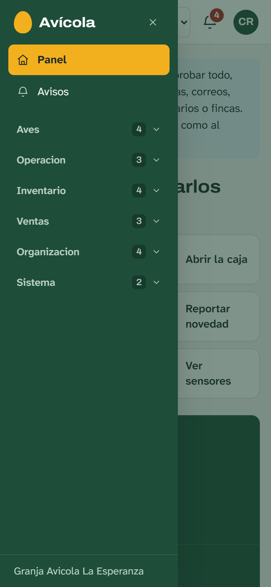

### Usarlo como aplicación en el celular

- **Android (Chrome):** abre Avícola, toca los tres puntos del navegador y elige **Instalar aplicación**
  o **Agregar a la pantalla principal**.
- **iPhone (Safari):** toca **Compartir** y luego **Agregar a pantalla de inicio**.

Queda con su ícono, como cualquier aplicación.

---

## 3. Qué puede hacer cada rol

Cada persona tiene un **rol**. El rol decide qué pantallas ve y qué puede hacer en ellas. Esto es lo que
trae el sistema de fábrica; el dueño lo puede cambiar en **Menú → Organizacion → Roles y permisos**.

| Tarea | Dueño | Supervisor | Cajero | Operario |
|---|:---:|:---:|:---:|:---:|
| Ver el panel y los avisos | Sí | Sí | Sí | Sí |
| Ver los reportes | Sí | Sí | No | No |
| Importar un Excel | Sí | Sí | No | No |
| Crear usuarios y darles contraseña nueva | Sí | No | No | No |
| Abrir y cerrar la caja | Sí | No | Sí | No |
| Vender | Sí | No | Sí | No |
| Anular una venta | Sí, de su turno abierto | No | Sí, de su turno abierto | No |
| Registrar la recolección de huevos | Sí | Sí | No | Sí |
| Registrar mortalidad | Sí | Sí | No | Sí |
| Registrar vacunas y tratamientos | Sí | Sí | No | Sí |
| Reportar novedades | Sí | Sí | Sí | Sí |
| Cerrar novedades | Sí | Sí | No | No |

> Hay además un rol de **Administrador**, que maneja toda la operación de la granja igual que el dueño,
> pero no cambia los permisos. Todo lo que dice la sección del dueño le sirve también.

**Para vender hay que tener la caja abierta a nombre propio.** Por eso el supervisor, que no abre caja,
no vende.

**Descuentos en la caja:** el cajero puede dar descuento hasta un tope (10 % de fábrica). El dueño y el
administrador no tienen tope.

---

## 4. Dueño (propietario)

El dueño ve y maneja todo en todas sus fincas. Su trabajo diario es revisar cómo va la granja; las
tareas de caja y de galpón están en las secciones del [cajero](#6-cajero) y del [operario](#7-operario).

### 4.1 Revisar el panel

Es lo primero que aparece al entrar. Resume la finca que tienes elegida.

- **La franja verde** tiene las tres cifras más importantes:
  - **Huevos disponibles:** los que hay para vender. Abajo dice cuántos **panales** de 30 son y cuántos
    huevos quedan **sueltos**. El dibujo del panal muestra esos huevos sueltos en amarillo.
  - **Aves en la finca:** aves vivas, qué tan llenos están los galpones y cuántos lotes hay.
  - **Vendido en 14 días:** el dinero que entró en las ventas de las últimas dos semanas.
- **Lo que pide atención:** tareas atrasadas, sensores fuera de rango, novedades sin cerrar y avisos.
  Cada línea tiene un enlace para ir a resolverlo. Si todo está en orden, esta parte no aparece.
- **Accesos rápidos:** botones grandes a lo más usado (recoger huevos, abrir la caja, registrar aves,
  reportar novedad, entrada de bodega y sensores).
- **Gráficas:** huevos recolectados y ventas por día. La barra más oscura es la de hoy. Pasa el mouse o
  el dedo por una barra para ver el número exacto.

En el celular, los accesos rápidos salen primero, porque es lo que más se usa en el galpón:

### 4.2 Ver los avisos

**Menú → Avisos**, o toca la **campana** de arriba.

El sistema revisa solo la granja y avisa cuando:

| Aviso | Cuándo aparece |
|---|---|
| **Queda poco** | Un artículo de la bodega está por debajo de su mínimo |
| **Sensor fuera de rango** | Un sensor midió algo fuera de lo normal (por ejemplo, mucho calor en un galpón) |
| **Refuerzo próximo o atrasado** | Una vacuna tiene refuerzo en los próximos 7 días, o ya se pasó la fecha |
| **Tarea atrasada** | Una tarea de días anteriores sigue sin hacer |
| **Novedad sin resolver** | Una novedad de gravedad alta sigue abierta |
| **Caja sin cerrar** | Quedó abierta una caja de un día anterior |

Pasos:

1. Mira primero los avisos con la etiqueta roja **Urgente**.
2. Toca un aviso para ir a la pantalla donde se arregla.
3. Cuando ya los viste todos, toca **Marcar todos como vistos**. Eso apaga el número de la campana.

**Los avisos se quitan solos** cuando el problema se resuelve: al comprar el artículo, al registrar el
refuerzo, al hacer la tarea, al cerrar la novedad o la caja. Marcarlos como vistos no los resuelve.

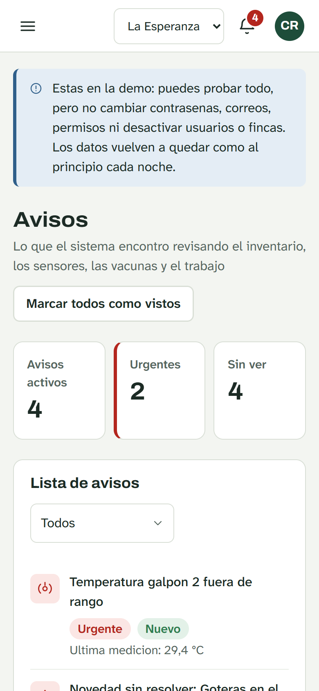

### 4.3 Ver los reportes

**Menú → Operacion → Reportes**

1. Elige el periodo en **Desde** y **Hasta**, o toca **Ultima semana** o **Ultimo mes**.
2. Lee la franja verde: huevos recolectados, dinero vendido, aves vivas y mortalidad del periodo.
3. Más abajo están:
   - **Produccion por tipo:** cuántos huevos hubo de cada tipo y cuántos panales son.
   - **Ventas por producto:** qué se vendió y cuánto dinero dejó, con el total en efectivo y en otros
     medios de pago.
   - **Alimento y aves:** kilos de alimento entregados, lo que costaron, kilos por ave, aves descartadas
     y aves vendidas.
   - **Para revisar:** tareas pendientes, novedades sin cerrar y artículos por debajo del mínimo.
4. Para llevar los datos a Excel, toca uno de los botones de **Descargar para Excel** (producción,
   ventas, movimientos de aves, alimento, existencias, novedades o tareas). El archivo baja listo para
   abrir en Excel.

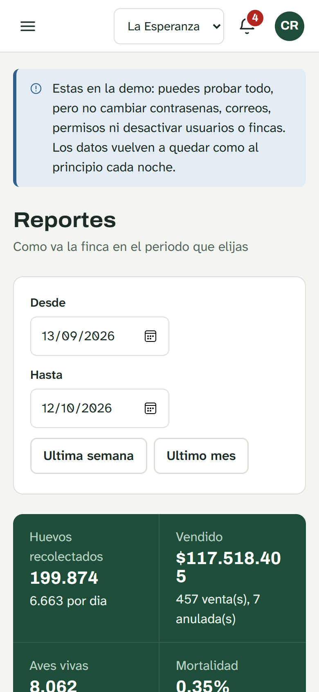

### 4.4 Importar un Excel

**Menú → Sistema → Importar desde Excel**. Sirve para subir información que ya tienes en Excel, **sin
cambiarle el formato**. También lo puede hacer el supervisor.

Se puede importar: artículos del inventario, entradas de inventario (alimento, insumos, vacunas),
proveedores, vacunas aplicadas y producción de huevos.

**Paso 1. Elegir el archivo**

| En el computador | En el celular |
|---|---|
|  | 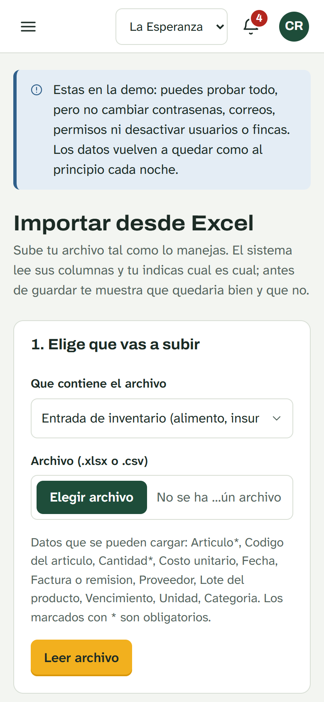 |

1. En **Que contiene el archivo**, elige qué vas a subir.
2. Toca **Elegir archivo** y busca tu archivo `.xlsx` o `.csv` (hasta 5 MB).
3. Debajo dice qué datos se pueden cargar. Los que tienen asterisco (\*) son obligatorios.
4. Toca **Leer archivo**. Todavía no se guarda nada.

**Paso 2. Emparejar las columnas**

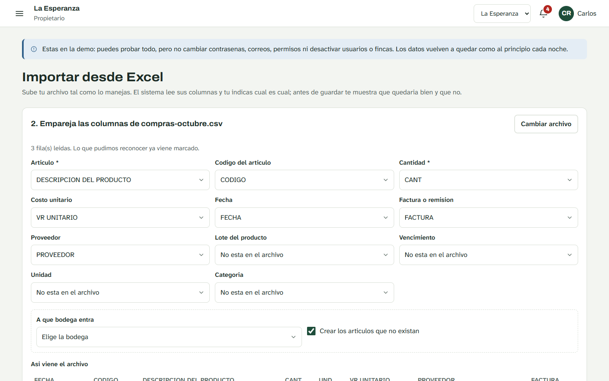

1. Para cada dato del sistema, elige la columna de tu archivo que lo tiene. Lo que el sistema reconoció
   ya viene marcado (por ejemplo, `CANT` como **Cantidad** o `VR UNITARIO` como **Costo unitario**).
2. Si un dato no está en tu archivo, deja **No esta en el archivo**.
3. Si es una entrada de inventario, elige en **A que bodega entra**.
4. Abajo, en **Asi viene el archivo**, puedes ver las primeras filas para confirmar.
5. Si vas a subir este mismo formato otras veces, escríbele un nombre y toca **Guardar plantilla**.
6. Toca **Revisar antes de guardar**.

**Paso 3. Revisar y guardar**

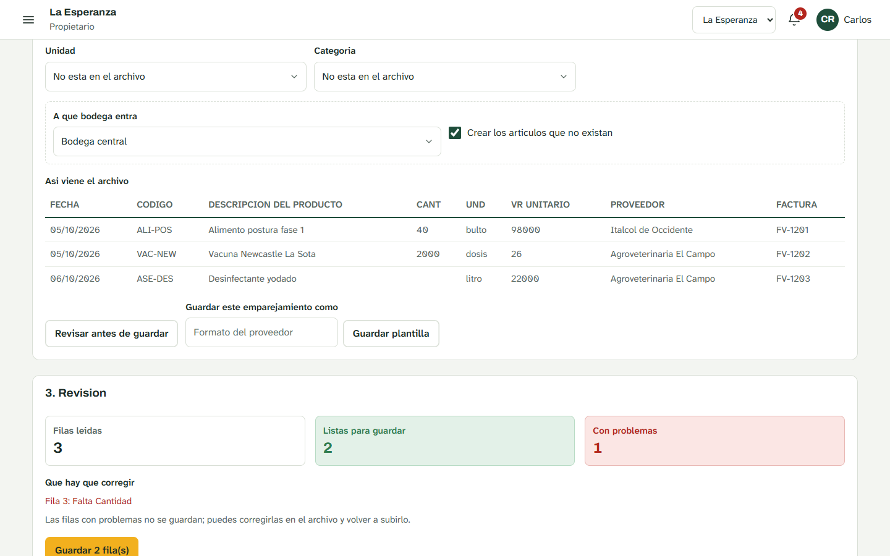

1. El sistema dice cuántas filas leyó, cuántas están **Listas para guardar** y cuántas tienen
   **problemas**.
2. En **Que hay que corregir** aparece cada fila con problema y el motivo (por ejemplo, *Fila 3: Falta
   Cantidad*). Esas filas no se guardan; corrígelas en tu Excel y súbelas otra vez.
3. Toca **Guardar**. El botón dice cuántas filas se van a cargar, por ejemplo **Guardar 2 fila(s)**: solo
   se guardan las buenas.

La importación queda en **Importaciones anteriores**. Si algo salió mal, **Deshacer** la revierte
completa.

### 4.5 Darle una contraseña nueva a quien la olvidó

**Menú → Organizacion → Usuarios**

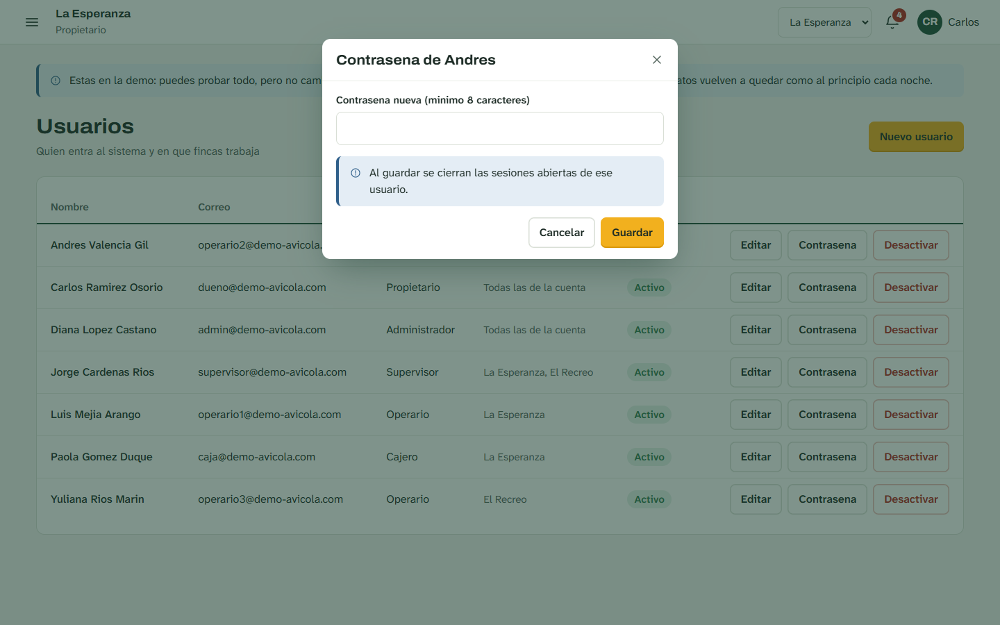

1. Busca a la persona en la lista.
2. Toca **Contrasena** en su fila.
3. Escribe una contraseña nueva de al menos 8 caracteres.
4. Toca **Guardar**.
5. Dale la contraseña a la persona en privado. Al entrar con ella, el sistema le pedirá cambiarla por una
   suya.

Al guardar, se cierran las sesiones que esa persona tuviera abiertas en otros equipos.

> En la demo pública no se pueden cambiar contraseñas: así nadie deja a los demás sin entrar.

---

## 5. Supervisor

El supervisor es el encargado de una o varias fincas. Hace casi todo lo de la operación; lo que no puede
es abrir la caja (y por eso no vende), crear usuarios ni cambiar permisos.

**Su día a día:**

1. Revisa el **panel** y los **avisos**: tareas atrasadas, sensores fuera de rango, refuerzos de vacunas
   y artículos por acabarse. Ver [Revisar el panel](#41-revisar-el-panel) y
   [Ver los avisos](#42-ver-los-avisos).
2. Mira cómo van los **lotes**: **Menú → Aves → Lotes**, y toca **Abrir** en un lote para ver su
   historia.

   | En el computador | En el celular |
   |---|---|
   |  | 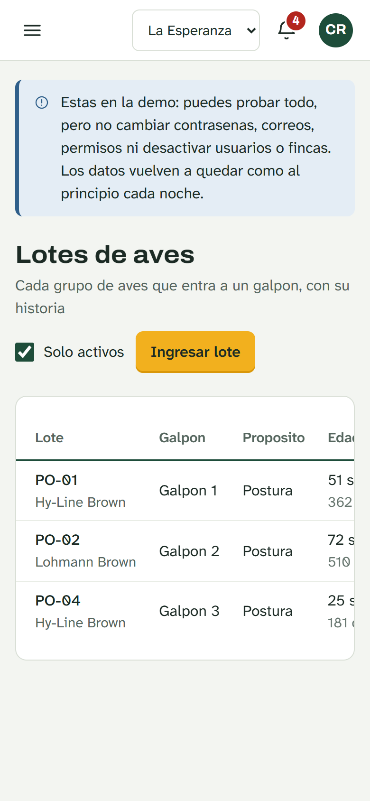 |

   En el detalle del lote ves sus aves, la mortalidad, el alimento, el peso y los costos hasta hoy:

   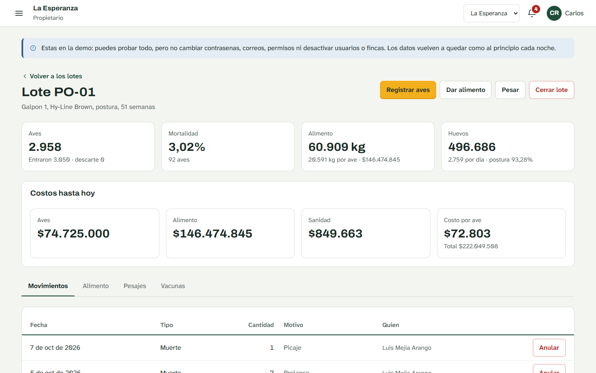

3. Registra o corrige lo que haga falta en el galpón: [recolección](#71-registrar-la-recolección-de-huevos),
   [mortalidad](#72-registrar-mortalidad) y [vacunas](#73-registrar-una-vacuna-o-tratamiento). Los pasos
   son los mismos que para el operario.
4. Revisa las **existencias de la bodega**: **Menú → Inventario → Bodegas**. La tabla **Que hay en las
   bodegas** dice cuánto queda de cada cosa y marca **Bajo minimo** lo que hay que comprar.

   | En el computador | En el celular |
   |---|---|
   |  | 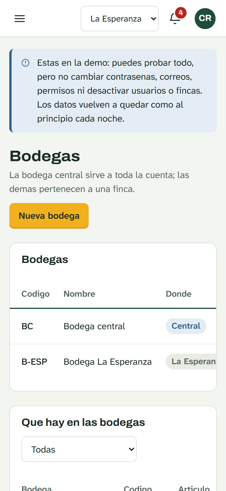 |

   En el celular, las tablas anchas se deslizan de lado con el dedo; la primera columna se queda fija.

5. **Cierra las novedades** que ya se resolvieron: **Menú → Operacion → Novedades**, toca **Cerrar
   novedad** y escribe qué se hizo.
6. Revisa los **reportes** e **importa Excel** cuando haga falta. Ver [Ver los reportes](#43-ver-los-reportes)
   e [Importar un Excel](#44-importar-un-excel).

Si una finca te aparece como **Solo consulta**, puedes revisarla pero no registrar nada en ella.

---

## 6. Cajero

El cajero atiende el punto de venta: abre la caja, vende, anula ventas de su turno y cierra la caja al
final del día.

**Menú → Ventas → Caja**, o el botón **Abrir la caja** del panel.

### 6.1 Abrir la caja

Sin caja abierta no se puede vender.

1. En **Punto de venta**, elige el tuyo.
2. En **Base inicial en efectivo**, escribe con cuánto efectivo empiezas (el sencillo para dar vueltas).
3. Toca **Abrir caja**.

Arriba aparece **Caja abierta** con el nombre del punto y tu turno.

### 6.2 Vender huevos

Los huevos se venden en cuatro presentaciones. Cada una es un producto distinto en la caja:

| Presentación | Huevos | Cómo aparece en la caja |
|---|---|---|
| Unidad | 1 | *Huevo AA por unidad* |
| Docena | 12 | *Docena huevo AA* |
| Medio panal | 15 | *Medio panal huevo AA x 15* |
| Panal | 30 | *Panal huevo AA x 30* |

1. **Toca el producto** en la lista de **Productos**. Cada uno muestra su precio en grande y cuánto
   queda disponible.
2. El producto pasa a **Venta actual**, a la derecha.
3. Para vender más de uno, toca **+**. Para quitar uno, toca **−**. También puedes escribir la cantidad
   en la casilla del medio.
4. Para sacar un producto de la venta, toca la **X** de esa línea.
5. Sigue con [Dar descuento y cobrar](#64-dar-descuento-y-cobrar).

**En el celular** la lista de productos ocupa la pantalla y abajo queda una barra fija con el total y el
botón **Cobrar**. Toca **Revisar** para ver la venta completa antes de cobrar.

| Productos y barra de cobro | Venta actual |
|---|---|
|  | 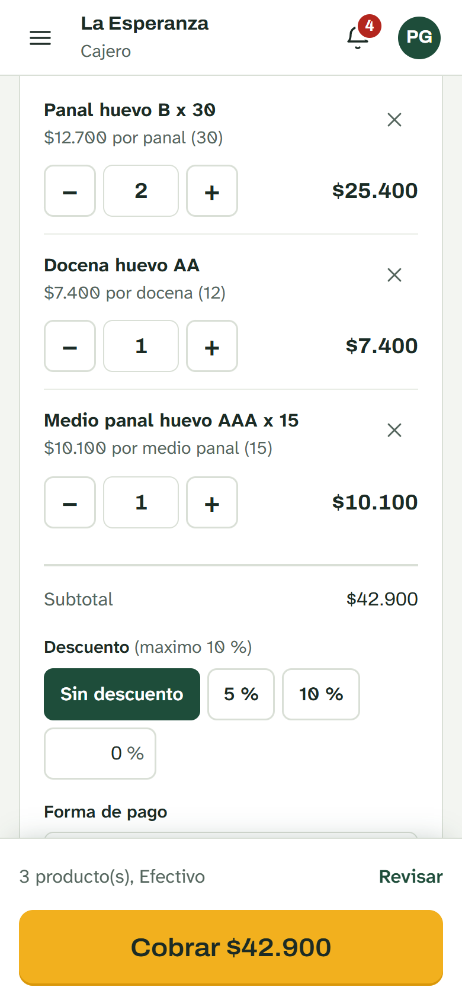 |

> Si no hay suficientes huevos, el sistema no deja cobrar y dice *No hay esa cantidad de huevos
> disponibles*. Pregunta si ya se registró la recolección del día.

### 6.3 Vender aves por unidad o por kilo

Las aves también son productos de la caja:

- **Gallinas de descarte** (las que ya no ponen): se venden **por unidad** o **por kilo**, según cómo las
  haya creado el dueño.
- **Pollo de engorde**: se vende **por kilo** (por ejemplo, *Pollo en pie (kg)*).

Los productos que se cobran por kilo muestran **/ kg** junto al precio.

**Por unidad:**

1. Toca el producto de aves.
2. Ajusta cuántas aves con **+** y **−**.
3. En **Lote**, elige de qué lote salen. La lista dice cuántas aves tiene cada uno.

**Por kilo:**

1. Toca el producto que dice **/ kg**.
2. En **Kilos**, escribe el peso total que marcó la báscula (por ejemplo `12.5`).
3. Si es pollo de engorde, escribe en **Cuantas aves** cuántos animales son.
4. En **Lote**, elige de qué lote salen.

Las aves vendidas se descuentan solas del lote y del galpón. No hay que registrarlas otra vez en el lote.

### 6.4 Dar descuento y cobrar

1. **Descuento:** si no hay, deja **Sin descuento**. Si hay, toca **5 %** o **10 %**, o escribe otro
   porcentaje en la casilla. Al lado de *Descuento* dice el máximo que puedes dar.
2. **Forma de pago:** elige **Efectivo** u otra (transferencia, tarjeta, crédito). Si no es efectivo,
   escribe la **Referencia** (el número de la transferencia o del comprobante).
3. Revisa el **Total**, en grande.
4. Toca **Cobrar**.
5. Aparece el **recibo** con el número de la venta, los productos, el descuento, el total y la forma de
   pago. Ciérralo con la **X**.

Si el descuento pasa de tu tope, el sistema no guarda la venta y te dice cuál es el máximo.

### 6.5 Anular una venta

Si te equivocaste en una venta, se anula y se vuelve a hacer bien.

1. Baja hasta **Ventas del turno**.
2. Busca la venta por su número y su hora. **Ver** abre el recibo para confirmar que es esa.
3. Toca **Anular**.
4. Escribe **por qué se anula**, con al menos 10 letras (por ejemplo, *se registró la cantidad
   equivocada*).
5. Toca **Anular venta**.

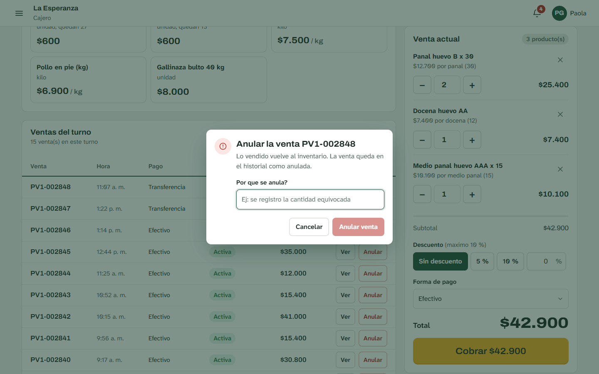

Los huevos y las aves de esa venta **vuelven** al inventario. La venta queda en la lista marcada como
**Anulada**.

Solo se pueden anular las ventas **del turno abierto**. Si la venta es de un turno que ya se cerró, no se
puede anular desde la caja: avísale al dueño para que lo tenga en cuenta.

### 6.6 Cerrar la caja

Al terminar la jornada:

1. Mira el recuadro **Estado de la caja**: la base, lo vendido, lo recibido en efectivo y cuánto **debe
   haber en caja**.
2. Cuenta el efectivo que tienes.
3. Toca **Cerrar caja**, arriba a la derecha.
4. Escribe el **Efectivo contado**. El sistema te muestra la **diferencia** con lo que debía haber.
5. Toca **Cerrar caja**.

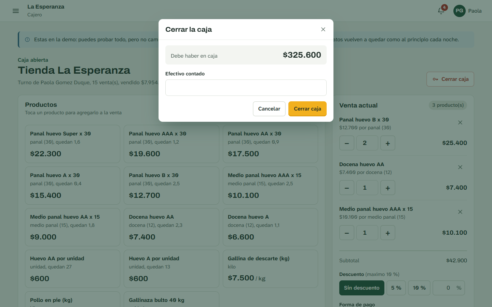

La diferencia queda guardada: si sobra o falta dinero, el dueño lo verá en **Menú → Ventas → Puntos de
venta**. Si una caja queda abierta de un día para otro, aparece un aviso en la campana.

---

## 7. Operario

El operario hace el trabajo diario del galpón y lo registra, casi siempre desde el celular.

**Su día a día:**

1. Revisa **Menú → Operacion → Tareas** para ver lo que le toca hoy. Toca **Empezar** al comenzar una
   tarea y **Marcar hecha** al terminarla.
2. Registra la recolección de huevos, la mortalidad, las vacunas y las novedades, como se explica abajo.

Los botones del panel llevan directo: **Recoger huevos**, **Registrar aves** y **Reportar novedad**.

### 7.1 Registrar la recolección de huevos

**Menú → Aves → Produccion de huevos**, o el botón **Recoger huevos** del panel.

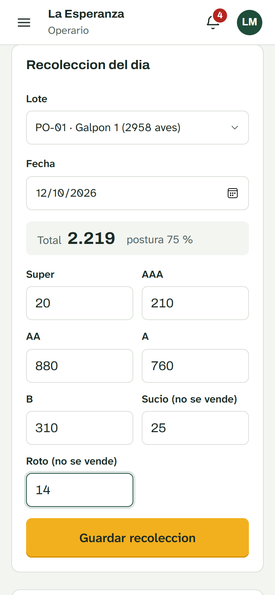

1. En **Lote**, elige el lote que recogiste.
2. Revisa la **Fecha** (trae la de hoy).
3. Escribe cuántos huevos hubo de cada tipo: **Super**, **AAA**, **AA**, **A**, **B**, **Sucio** y
   **Roto**. Si de un tipo no hubo, déjalo vacío.
4. Mientras escribes, arriba se ve el **Total** y el porcentaje de **postura** (cuántas gallinas
   pusieron).
5. Toca **Guardar recoleccion**.
6. Repite con el siguiente lote.

- Los sucios y los rotos se registran pero **no se venden**.
- **¿Te equivocaste?** Vuelve a registrar el mismo lote y la misma fecha con los números correctos. El
  sistema corrige el registro anterior; no lo duplica.
- No se puede registrar la recolección de un día que todavía no llega.

### 7.2 Registrar mortalidad

**Menú → Aves → Lotes**, toca **Abrir** en el lote y luego **Registrar aves**. También sirve el botón
**Registrar aves** del panel.

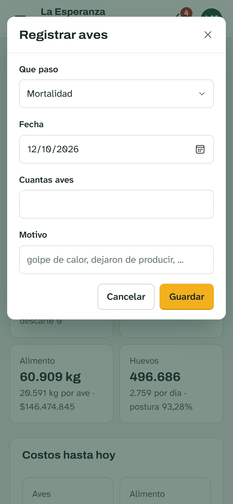

1. En **Que paso**, deja **Mortalidad**.
2. Revisa la **Fecha**.
3. En **Cuantas aves**, escribe cuántas murieron.
4. En **Motivo**, escribe la causa si la sabes (por ejemplo, *golpe de calor*).
5. Toca **Guardar**.

Las aves se restan del lote y la mortalidad del lote se actualiza sola.

En **Que paso** también están los otros casos: descarte, venta de aves fuera de la caja, fuga, robo,
consumo en la finca, regalo, ingreso de más aves y traslado a otro galpón.

**Si te equivocaste:** avísale al supervisor. Él lo anula en el detalle del lote, pestaña
**Movimientos**, con el botón **Anular** y el motivo. Las aves vuelven a quedar como estaban.

### 7.3 Registrar una vacuna o tratamiento

**Menú → Aves → Vacunas y tratamientos**, y toca **Registrar aplicacion**.

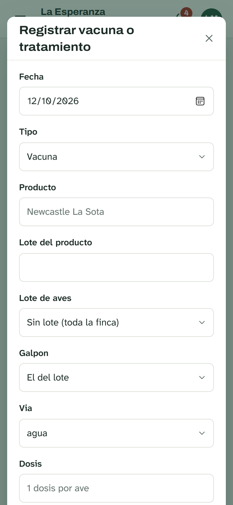

1. Revisa la **Fecha**.
2. En **Tipo**, elige: vacuna, medicamento, vitamina, desinfección u otro.
3. En **Producto**, escribe el nombre que trae el frasco (por ejemplo, *Newcastle La Sota*).
4. En **Lote del producto**, copia el lote que trae el frasco. Sirve si después hay que rastrearlo.
5. Elige a quién se le aplicó: el **Lote de aves**, o el **Galpon** si fue una desinfección.
6. En **Via**, elige cómo se dio: agua, ocular, aspersión, inyectado o alimento.
7. Escribe la **Dosis** y cuántas **aves** se trataron.
8. Si hay que repetirla, pon la fecha del **próximo refuerzo**. El sistema avisará 7 días antes.
9. Si salió de la bodega, elige el producto, la bodega y la cantidad usada para que se descuente del
   inventario.
10. Toca **Guardar**.

### 7.4 Reportar una novedad

Una novedad es todo lo que se sale de lo normal: un daño, una plaga, un corte de luz o de agua, un robo,
un problema de salud del lote. La pueden reportar todos, también el cajero.

**Menú → Operacion → Novedades**, y toca **Reportar novedad**. También está el botón **Reportar
novedad** del panel.

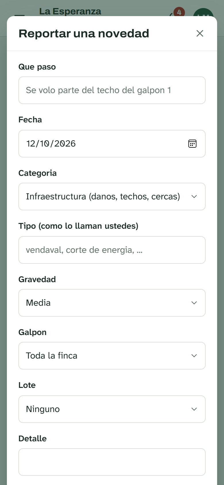

1. En **Que paso**, escribe un título corto: *Se voló parte del techo del galpón 1*.
2. Revisa la **Fecha**.
3. Elige la **Categoria**: infraestructura, clima, animales, servicios, seguridad, salud del lote u otro.
4. En **Tipo**, escribe cómo lo llaman ustedes: *vendaval*, *corte de energía*, *zarigüeya*.
5. Elige la **Gravedad**: baja, media o alta. Las de gravedad **alta** aparecen en la campana hasta que
   alguien las cierre.
6. Si fue en un galpón o un lote, elígelo.
7. En **Detalle**, cuenta lo que viste.
8. Si murieron aves, escribe cuántas en **Aves afectadas**: se descuentan del lote en el mismo registro.
9. Si sabes cuánto cuesta arreglarlo, escríbelo en **Costo estimado**.
10. Toca **Guardar**.

Cuando el problema se resuelva, el supervisor o el dueño la cierran con **Cerrar novedad**.

---

## 8. Recuperar la contraseña

*Esta parte es para todos.*

Avícola no tiene un botón de "olvidé mi contraseña": la contraseña nueva te la da una persona de la
granja, para que nadie más pueda pedirla por ti.

1. Habla con el **dueño** o el **administrador** de la granja y pídele una contraseña nueva.
2. Él la asigna en **Usuarios → Contrasena** (los pasos están en
   [Darle una contraseña nueva a quien la olvidó](#45-darle-una-contraseña-nueva-a-quien-la-olvidó)).
3. Entra con la contraseña que te dio.
4. El sistema te pide cambiarla por una tuya, de al menos 8 caracteres. Escríbela dos veces y guarda.

**Para cambiar tu contraseña cuando quieras:** toca tu nombre arriba a la derecha, elige **Mi cuenta**,
escribe la actual y la nueva dos veces, y toca **Guardar**.

Si el que olvidó la contraseña es el dueño, debe pedírsela a quien instaló el sistema.

---

## 9. Preguntas frecuentes

**No veo una opción del menú.**
Tu rol no tiene permiso para esa pantalla. Pídele al dueño que lo revise en **Roles y permisos**.

**Registré algo en la finca equivocada.**
Anula el registro, cambia la finca en la lista de arriba y vuelve a registrarlo.

**Me equivoqué en la recolección de huevos.**
Vuelve a registrar el mismo lote y la misma fecha con los números correctos. Se corrige solo.

**Me equivoqué en una venta.**
Anúlala con el motivo y vuelve a hacerla. Solo se pueden anular las ventas del turno que está abierto.

**Me equivoqué al registrar la mortalidad.**
El operario no puede anularla. Avísale al supervisor para que la anule y vuelve a registrarla bien.

**La caja dice "No hay esa cantidad de huevos disponibles".**
Falta registrar la recolección del día o esos huevos ya se vendieron. Revísalo en **Produccion de
huevos → Huevos disponibles**.

**No me deja cobrar una venta de aves.**
Revisa que hayas elegido el **Lote** de donde salen y, si es pollo de engorde, **Cuantas aves** son. El
mensaje rojo encima del botón **Cobrar** dice qué falta.

**El descuento no pasa.**
Superaste el tope de descuento de tu rol. El mensaje dice cuál es el máximo.

**Cerré la caja y no cuadró.**
La diferencia queda guardada con el turno. El dueño la ve en **Puntos de venta → Turnos de caja**. No se
puede volver a abrir un turno cerrado.

**La campana sigue avisando algo que ya resolví.**
Los avisos se quitan cuando el problema de verdad se resuelve: se compró el artículo, se hizo la tarea,
se cerró la novedad. **Marcar todos como vistos** solo apaga el número.

**El Excel no se lee bien.**
Revisa que la primera fila con datos sea la de los títulos de las columnas. Si arriba hay títulos sueltos
o filas vacías, bórralos y vuelve a subirlo. En el paso 2 puedes elegir a mano cada columna.

**No me deja cerrar el lote.**
Todavía quedan aves vivas o de descarte. Regístralas como venta, mortalidad o traslado antes de cerrar.

**Un sensor dice "Sin datos".**
El equipo no está enviando mediciones. Revisa que esté encendido y con internet.

**¿Puedo usarlo sin internet?**
No. Avícola necesita internet para guardar cada registro. Si se va la señal en el galpón, anota los
números en papel y regístralos cuando vuelva.

**Olvidé mi contraseña.**
Mira [Recuperar la contraseña](#8-recuperar-la-contraseña).

---

## 10. Palabras que usa el sistema

| Palabra | Qué quiere decir |
|---|---|
| **Finca** | Cada granja de la empresa. Trabajas en una a la vez |
| **Galpón** | La construcción donde viven las aves |
| **Lote** | Un grupo de aves que entró junto a un galpón, con su raza y su edad |
| **Postura** | Producción de huevos. El porcentaje de postura es cuántas gallinas pusieron ese día |
| **Engorde** | Pollos criados para carne |
| **Descarte** | Gallinas que ya no ponen y se venden |
| **Panal** | Cubeta de 30 huevos. Medio panal son 15 |
| **Turno** | El tiempo entre abrir y cerrar la caja |
| **Base** | El efectivo con el que se abre la caja |
| **Anular** | Deshacer un registro sin borrarlo; queda a la vista con el motivo |
| **Refuerzo** | La siguiente dosis de una vacuna o tratamiento |
| **Novedad** | Algo que se salió de lo normal en la finca |
| **Solo consulta** | Puedes ver la finca pero no registrar nada en ella |

---

*Avícola: manual de usuario.*
